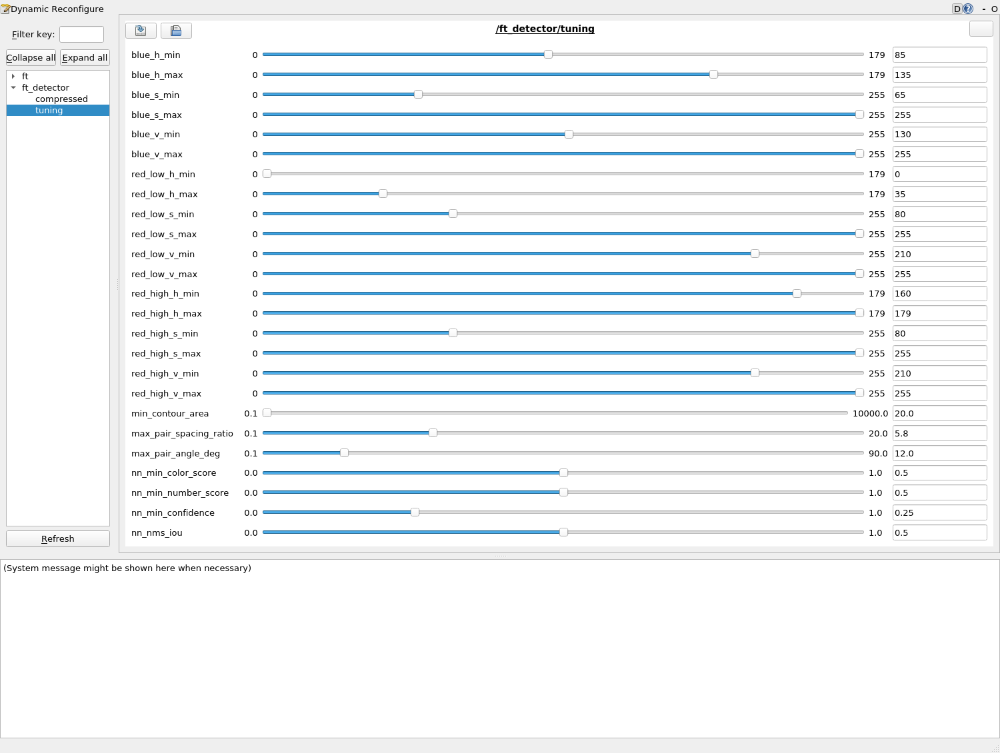
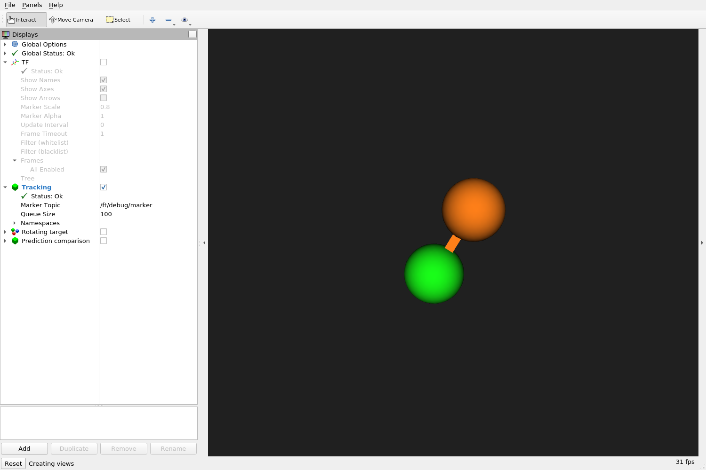
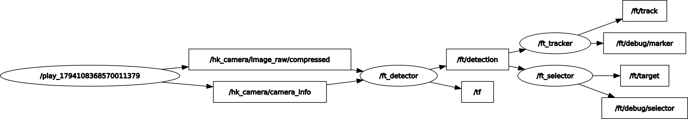

# 视觉组最终考核：装甲板自瞄感知链路

基于 ROS Noetic、OpenCV 和 ONNX Runtime 的独立 catkin 工作空间，实现图像接入、传统/神经网络装甲板识别、PnP、单板平移跟踪、车体旋转估计和装甲板选择。实施计划见归档 [PLAN.md](docs/PLAN.md)，完整目录与文件用途见[文件介绍](docs/file_guide.md)。

## 仓库结构

源码与文档结构如下：

```text
vision_final_test/
├── src/
│   ├── ft_detection/    # 素材提供的检测消息
│   ├── ft_msgs/         # Track、Target 消息
│   ├── ft_detector/     # 图像接入、识别、PnP、TF 和调参
│   ├── ft_tracker/      # 单板匀速跟踪与提前量
│   ├── ft_selector -> ../bonus/rotation_prediction/ft_selector
│   ├── ft_bringup/      # 参数、启动和可视化配置
│   └── ft_rqt_gui -> ../bonus/gui/ft_rqt_gui
├── bonus/
│   ├── gui/            # rqt 调试控制台
│   ├── rotation_prediction/ # 旋转预测改进、投影工具与对照结果
│   └── detection_improvements/ # NN 板型、传统/NN 动态 ROI 与线程优化
├── tools/              # 资源准备、性能统计和辅助对比
├── docs/               # 文件介绍、学习问答和结果配图
├── ai_usage.md         # AI 辅助范围与我的决策
├── README.md           # 构建与使用入口
└── run.sh              # 环境准备、构建、启动和回放
```

每个 ROS 包包含自己的 package.xml 和 CMakeLists.txt；算法包的 include/ 声明接口，src/ 实现算法和 ROS 节点。原始素材放入 task/，视频放入 video/，与 assets/、build/、devel/ 等本地资源和生成物一起由 Git 忽略。

## 环境与构建

环境为 Ubuntu 20.04、ROS Noetic、OpenCV 4.2.0、Eigen3、catkin tools、工具所需的 libyaml-cpp-dev，以及 curl、Python pip/OpenCV/YAML。推理使用 ONNX Runtime 1.22.0 CPU C++ 包。神经网络与旋转选板使用 C++17，其余算法库使用 C++14。ROS 依赖见各包的 package.xml。

在项目根目录执行：

```bash
./run.sh setup-inference
./run.sh prepare-model
./run.sh check
./run.sh build
```

前两条仅需在首次准备或资源缺失时运行：依赖保存在 .deps/，模型及样例保存在 assets/。脚本自动加载 Noetic 和本项目环境，构建结果保存在本项目。各模块的接口与算法约定按下面的题目编号说明。

## 运行

完成构建后，启动图形化控制台：

```bash
./run.sh gui
```

控制台可选择素材、模式、倍率和功能，支持传统／NN 对比及 Baseline／Candidate 跨工作区对比；图像和参数同窗显示，RViz 可双窗联动。操作与限制见 [GUI 说明](bonus/gui/README.md)，附加模块见 [bonus 目录](bonus/README.md)。

命令行启动方式：

将原始 bag 放入 task/，在同一 Noetic 环境的两个终端中，从项目根目录执行：

终端一启动检测、跟踪、选板和可视化。

```bash
./run.sh launch dataset:=red_4 rviz:=true reconfigure:=true
```

终端二，开始回放：

```bash
./run.sh play red_4 -r 0.2
```

RViz 收到首份有效 CameraInfo 帧名后才打开，固定坐标系自动选择。`-r 0.2` 为慢速回放，去掉即可原速；可加 `--pause` 暂停启动或 `-l` 循环。回放终端按空格暂停/继续，Ctrl+C 结束。

| 数据集参数 | 素材文件 |
|---|---|
| blue_1 | task/blue_1.bag |
| blue_guard | task/blue_guard.bag |
| red_1_3 | task/red_1&3.bag |
| red_4 | task/red_4.bag |

两个终端的数据集须一致；切换时先停止旧启动和回放。`gui` 控制图像窗口，`rviz` 控制 RViz，`reconfigure` 控制调参窗口；三者均为 false 时可用于无桌面运行。调参窗口等动态服务就绪后打开，不需要开始回放。

默认启动检测、跟踪和选板。用 `tracker:=false` 或 `selector:=false` 分别关闭对应节点，同时设置两者为 false 可单独运行检测。RViz 的绿色球是单板当前估计，橙色球是 T 秒后的线性预测，纯预测时标记变淡。

默认 `mode:=tradition`，用 `mode:=nn` 选择神经网络。独立对比工具同时运行两种检测。

```bash
./run.sh compare dataset:=red_1_3 mode:=nn
./run.sh play red_1_3 -s 2 -r 0.15
```

两条命令分别在两个终端运行。rqt 选择 `/ft/debug/comparison`，左侧传统、右侧 NN，按图像时间戳和坐标系对齐。mode 指定正式链路使用的模式，辅助检测通过独立话题供拼图使用。RViz 灰线由预测对照工具发布。正常运行使用 launch，模式切换需重启。

<details>
<summary>不使用 run.sh 时的启动与回放命令</summary>

两个终端均先加载环境：

```bash
source /opt/ros/noetic/setup.bash
source devel/setup.bash
```

分别执行：

```bash
# 终端一
roslaunch ft_bringup demo.launch dataset:=red_4 rviz:=true reconfigure:=true
# 终端二
rosbag play --clock task/red_4.bag --topics /hk_camera/image_raw/compressed /hk_camera/camera_info -r 0.2
```

</details>

## 第一点：图像接入与相机参数

使用 image_transport 的 compressed 插件和 cv_bridge 接入图像，缓存最新有效 CameraInfo，从中读取 K、D、图像尺寸和实际 frame_id。相机内参不写死，业务消息沿用输入图像时间戳与坐标系。

四份素材共用 `/hk_camera/image_raw/compressed` 和 `/hk_camera/camera_info`；回放仅提供相机输入和 `/clock`。输入话题与小队列长度在 [detector.yaml](src/ft_bringup/config/detector.yaml) 中配置，bag 文件名在 [datasets/](src/ft_bringup/config/datasets) 中配置。

## 第二点：传统装甲板识别

传统模式依次进行 HSV 颜色分割、轮廓筛选和灯条配对。蓝色使用单区间，红色合并两段区间；根据灯条长度、角差、高差和间距筛选候选，拒绝共享灯条的明显劣配与歧义配对，再按归一化间距区分大小板。

一帧中的多个候选均保留，按位置排序分配帧内 ID。识别框、ID 和大小显示在 `/ft/debug/image`；`debug_details: true` 可显示灯条下标和拒绝原因。传统模式另发布 `/ft/debug/mask/blue`、`/ft/debug/mask/red` 两路 HSV 掩膜。

传统模式默认启用多目标动态 ROI：全图确认目标后局部跟随，并定期全图发现新目标，丢失时恢复搜索。配置位于 `detector.yaml` 的 `traditional/roi`，关闭后恢复全图检测。调试几何和掩膜保持原图坐标及尺寸，未搜索区域的掩膜为黑色。`red_4` 固定连续片段中，反光误检从 29 帧降到 0 帧，真板检出数保持一致；方法、截图及限制见 [识别改进](bonus/detection_improvements/README.md#传统-roi-的反光对照)。

## 第三点：位姿解算与 TF

采用定义一：一对灯条的四个端点，顺序为左上、右上、右下、左下。装甲板原点在四点中心，X 沿板向右、Y 沿板向下、Z=X×Y 指向板背后；相机光学系为 x 右、y 下、z 前，均为右手系。

PnP 使用 IPPE 求平面候选，检查正深度和重投影误差，并在有效历史存在时辅助消歧。变换为 P_camera=R×P_armor+t，TF 以相机为父系、armor_<帧内ID> 为子系，直接使用 R 和 t。重投影坐标轴为 X 红、Y 绿、Z 蓝。

端点尺寸暂用小板 135×56 mm、大板 230×56 mm，参考 Alliance2026 开源参数，尚未与素材实物核对。YAML 保留 `confirmed: false` 和临时尺寸开关；`provisional` 表示采用临时尺寸模型。重投影检查通过仍不能证明实物米制精度，首次朝向仍可能存在平面双解歧义。

下图为原始 red_4 回放时的 RViz TF 界面，左侧显示 armor_0 的父坐标系及位置，右侧显示对应的三条坐标轴。


## 第四点：消息发布与可视化

| 输出 | 内容 |
|---|---|
| `/ft/detection` | ft_detection/DetectionFrame，有效检测及带图像 header 的空检测帧 |
| `/ft/debug/image` | 框、角点 0～3、帧内 ID、颜色、大小、位姿轴及深度/重投影误差 |
| `/tf` | 相机坐标系到 armor_<帧内ID> 的变换 |

四点顺序为左上、右上、右下、左下；角点 x/y 单位像素、z 固定为 0，位姿和 TF 平移单位米。Detection.id 仅在帧内有效，位姿过滤后可不连续。confidence 在传统模式为几何评分，在神经网络模式为颜色分数×编号分数；模型编号另显示为 #1、#3 等，不替代帧内 ID。

每张成功处理的图像均发布检测帧，无有效位姿时 detections 为空。另开终端查看一帧非空消息：

```bash
source /opt/ros/noetic/setup.bash
source devel/setup.bash
rostopic echo --filter 'len(m.detections) > 0' -n 1 /ft/detection
```

用 rqt_image_view 选择 `/ft/debug/image`，可以看到识别框、角点编号、帧内 ID、大小、位姿轴和重投影信息。下图为原始 red_4 回放中的实际窗口。


## 第五点：参数化与动态调参

话题、传统识别及 PnP 参数位于 [detector.yaml](src/ft_bringup/config/detector.yaml)，神经网络协议、阈值和线程设置位于 [model.yaml](src/ft_bringup/config/model.yaml)。按 detector→model→数据集顺序加载，后加载的同名键覆盖前值。

统一启动的 `reconfigure:=true` 会打开调参窗口。也可在另一个 Noetic 终端手动打开：

```bash
source /opt/ros/noetic/setup.bash
source devel/setup.bash
rosrun rqt_reconfigure rqt_reconfigure
```

选择 `/ft_detector/tuning`：传统检测有 33 项 HSV/几何字段；NN 使用颜色分数、编号分数、联合分数、NMS IoU，以及共用的大小板分界。`/ft_tracker/tuning` 提供 Q/R、位置关联门限和 T；`/ft_selector/tuning` 提供旋转 EKF 的噪声、观测方差、位置/角度关联门限、换板代价优势、冷却时间和 T。在线修改保留当前轨迹与已有冷却起点。

滑块释放后生效；不合法组合整组恢复上一次有效配置。当前值及“Set to Default”来自启动 YAML，在线修改不会写回文件。GUI 按运行侧、模式和模块过滤参数，并用一个 T 控件联动所选侧的两种预测；单独使用 rqt_reconfigure 时，各节点的 T 分别设置。半径、板数、物理尺寸及其他未开放参数仍修改 YAML 后重启。

调参对照：在 blue_1 的同一帧中，将 blue_v_min 从 130 提高到 240，蓝色掩膜白像素从 2795 减少到 1686，检测数从 2 变为 0；恢复为 130 后结果恢复。提高亮度下限会收紧筛选，也可能漏掉原来能识别的目标。

参数窗口选中 `/ft_detector/tuning` 后可看到检测字段及其滑块。标准 rqt_reconfigure 显示完整服务字段，本项目 GUI 则隐藏当前模式不使用的字段。



## 第六点：单目标平移跟踪与提前量

[tracker.yaml](src/ft_bringup/config/tracker.yaml) 配置六维匀速卡尔曼滤波：状态为位置和速度，dt 来自图像时间戳。Q 采用随 dt 积分的白加速度噪声，表示对预测的不确定性，q=2 m²/s³；R 为 0.0025 m²（位置标准差 5 cm），表示对观测的不确定性。关联距离门限为 0.5 m。

q 用于允许短时加减速，R 以 5 cm 的位置噪声作初始假设，0.5 m 门限用于容纳相邻帧预测误差，同时按颜色与大小限制关联。

首次选最近目标，之后在预测位置附近关联并保持锁定；漏检时 `tracking=false`，超过 0.5 s 删除。`id=0` 表示无轨迹，正 ID 表示已有轨迹；轨迹 ID 与帧内检测 ID 不同。`position_predict=position+T*velocity`，默认 T=0.1 s。

`/ft/track` 发布 ft_msgs/Track，包含轨迹 ID、命中标志、位置、速度和提前量位置。`/ft/debug/marker` 显示绿色当前位置、橙色未来位置及连线，纯预测时标记变淡。位置单位为 m，速度为 m/s，T 为 s。相机运动、同类目标交叉和旋转换板可能影响关联。

动态调参实验中，我观察到：调大 q 后，预测更激进、抖动增大；调大 R 后，预测响应变迟钝；调大关联距离门限后，预测小球更容易乱跳。在该实验条件下，q=2 m²/s³、R=0.0025 m²、关联距离门限约 0.5 m 时，预测较稳定。

下图为 red_4 运动片段的 RViz Marker 界面，订阅 `/ft/debug/marker`。绿色球为当前估计位置，橙色球为 T=0.1 s 的预测位置，橙线连接两者。



## 第七点：基础链路跑通

统一入口为 demo.launch，上文的 run.sh launch 会加载检测、跟踪和可视化配置。图像、RViz 和动态调参窗口分别由 gui、rviz、reconfigure 控制；RViz 从有效 CameraInfo 自动选择固定坐标系。

回放后用 rqt 查看 `/ft/debug/image`，在 RViz 查看装甲板 TF 与提前量 marker，并通过动态调参观察识别效果变化。

## 第八点：神经网络推理

使用 ONNX Runtime 1.22.0 CPU C++ 后端，`mode:=nn` 选择神经网络，`mode:=tradition` 选择传统识别，切换需重启。

输入 images 为 RGB float32 NCHW `[1,3,480,640]`：等比缩放、居中补边 124、除以 255。输出 output0 为 `[1,21,6300]`，按 channel×6300+candidate 读取，不再 sigmoid。

| 输出通道 | 含义 |
|---|---|
| 0～3 | 蓝、红、熄灭、其他分数 |
| 4～12 | 九项编号分数：哨兵、1、2、3、4、5、前哨站、基地、基地 |
| 13～20 | 四个角点，模型点序为左上、左下、右下、右上 |

颜色和编号分别取最高分类，只有胜出颜色为红或蓝才继续筛选。四点按 0/3/2/1 重排为公共点序，减去补边后除以实际横纵缩放比例还原到原图，再接入共用 PnP 和跟踪。

默认颜色/编号分数门限为 0.5/0.5，乘积门限 0.25；取最高分的至多 300 个合法候选，按四点外接框做跨类别 NMS，IoU 门限 0.5。大小分类先使用公共几何规则，再按下文编号策略修正。模型原件、派生模型及哈希清单位于 assets/models/，派生仅改变节点顺序。

NN 在几何判型之后可使用高置信编号修正大小板，并通过多目标动态 ROI 搜索；角点始终恢复为原图坐标。编号用于内部判型和调试显示，不作为独立消息字段或跟踪约束。两个功能在 model.yaml 中独立配置，具体规则、改善片段、线程测量与使用方式见 [NN 识别改进](bonus/detection_improvements/README.md)。

上文的 run.sh compare 同时启动两种检测，发布 `/ft/debug/comparison` 同帧拼图，左传统、右 NN；正式链路只使用 mode 选中的结果。耗时统计见[性能工具说明](tools/README.md)。

改进前的全图检测配置、默认分数门限下，两张样例的结果如下。这里统计通过 PnP 的有效检测数，仅说明这两张图的输出，不作为全段识别准确率。

| 样例 | 传统方法 | 神经网络 |
|---|---:|---:|
| sample_1.jpg | 1 | 2 |
| sample_2.jpg | 1 | 3 |

下图来自原始 red_1_3 第 2 秒起的 0.6 s 回放片段，是 compare 工具实际发布的一帧：左侧传统方法得到 1 个有效检测，右侧 NN 得到 2 个，均使用同一输入图像。画面保留四点、帧内 ID、位姿轴和临时尺寸标记。平均处理耗时与测量范围见[第十点](#第十点全链路集成与性能)。


## 第九点：旋转目标建模与装甲板选择

用两个终端启动选板并回放：

```bash
./run.sh launch dataset:=blue_guard mode:=nn rviz:=true
./run.sh play blue_guard -u 3 -r 0.15
```

旋转 EKF 使用十一维状态 `[cx,cy,cz,vx,vy,vz,θ,ω,r,Δr,Δh]`，估计参考圆心、平移速度、相位、角速度和两组几何。四块板等角分布，槽位 0/2 的半径为 r，槽位 1/3 为 r+Δr。Δh 表示奇数组板中心相对偶数组的高度差，正值向上；相机 Y 向下，因此奇数组 Y=cy−Δh。它不是装甲板本身的高度。

模型参考[同济 sp_vision_25 的两组几何建模](https://github.com/TongjiSuperPower/sp_vision_25/blob/bd9f5e7/tasks/auto_aim/target.cpp)，按本项目的相机 X-Z 旋转平面重新实现。用图像时间差预测，角度和角残差环绕到 ±π，换板保持车体 ID。默认半径 0.25 m 是初值，Δr、Δh 从零开始；几何初始方差、小幅随机游走噪声及范围在 [selector.yaml](src/ft_bringup/config/selector.yaml) 的 geometry 中设置。两组半径默认允许 0.05～0.50 m，|Δh|≤0.20 m。越界校正整组拒绝；观察量、转角或两组覆盖不足时显示 geometry warming up，不将初值称为实测尺寸。两板、三板模式只估计共同半径。

首次选最近的有效板；已有轨迹时，将各模型槽位与同色观测配对，位置差门限为 0.40 m、角差门限为 0.70 rad。通过门限后，各槽位分别保留归一化位置误差和角误差平方和最小的候选，每帧只用一组观测校正，换槽位不更换车体 ID。

当前板关联带有代价保持和换板冷却：当前槽位有合法观测时，冷却期间继续用它校正；冷却结束后，新板须有足够的代价优势才切换。当前槽位失配时绕过冷却，同帧尝试其他合法观测。启动配置位于 `selector.yaml` 的 `association_hysteresis`，推荐 `cost_margin=0.01`、`cooldown_s=0.02`。GUI 的 `Parameters → Rotating tracking` 可在线调整 `switch_cost_margin` 和 `switch_cooldown_s`，仅影响所选侧，重启恢复 YAML；冷却使用图像时间，两项均为 0 恢复原最低代价规则。实际片段、未来误差及限制见[选板保持对照](bonus/rotation_prediction/README.md#选板保持的连续片段对照)。

未来选板先按 c+vT 和 θ+ωT 推进圆心与相位，再遍历各槽位。预测坐标须有限、深度为正，板的朝外法向与指向相机方向的点积须大于 0.20，取其中最高分槽位。本帧有匹配观测、当前板深度为正且未来选板成功时 valid=true。

`/ft/target` 发布 ft_msgs/Target，包含车体 ID、有效标志、当前板和未来选中板的位置。未来板由模型计算，可属于当前不可见的另一槽位。短时漏检时 `valid=false`，保留车体 ID 并以半透明 marker 显示预测；失联超过 0.5 s 时清除车体 ID 和 marker。

`/ft/debug/selector` 的青色方块表示车体中心，紫色球是当前板，蓝色球是 T 秒后最朝向相机的板。橙色球仍为单板匀速预测。运行 compare 工具时，`/ft/debug/prediction_comparison` 在同时间戳、同坐标系且两路有有效观测时，用灰线连接两个预测点。

蓝紫用于看提前选板，蓝橙用于比较两种预测。判断偏差时，将同一帧发出的预测与 T 秒后的可见板对应。相机运动、突然变速或模型几何不符都可能使旋转预测失效。

统一 launch 或 GUI 开启选板后，独立投影工具自动发布 `/ft/debug/prediction_image`，保留原检测图。紫色四边形表示当前模型板，蓝色表示 t+T 时刻选中的板；叠加在 t 时刻图像上，仅用于直观观察。四点、尺寸沿用 PnP 的灯条端点定义，安装倾角参考最近一次有效观测，通过相机内参与畸变投影。底部显示槽位、几何值、不确定性与视野检查；进入视野不代表没有实际遮挡。

GUI 的 Images 提供每侧预测叠加及预测拼图，随选板自动启停，不设独立开关。旧 Baseline 缺少完整姿态时显示黄色预测中心十字，并明确标注 center only。`/ft/target` 保持原消息定义；`/ft/debug/rotation_prediction` 记录同次预测使用的 T、源时间、未来时间、位姿和几何状态。


T 秒后的精度需把 t 时刻保存的预测与 t+T 图像对齐，不能用当前图像上的重合程度代替。延迟对照采用独立离线测量。模型假设相机稳定、旋转轴近似相机 Y、未来板沿用当前观测的板型与共同安装倾角；姿态噪声、变速、错误关联、遮挡和尺寸偏差仍可能影响预测。`red_1_3` 和相机较稳定的 `blue_1` 可用于检查这些条件下的延迟预测；`blue_guard` 存在明显云台/相机运动，在没有惯性系补偿的模型中作为运动相机下的失效样例。

旋转预测的 Before / Change / After、实际观察、T 秒后的对照结论和配图，见 [旋转预测附加题说明](bonus/rotation_prediction/README.md)。

## 第十点：全链路集成与性能

默认统一启动检测、平移跟踪和旋转选板，支持 tradition / nn 模式。tracker、selector 分别控制两个下游节点，两者均直接订阅检测结果。

独立基准复用现有算法库，统计各阶段耗时的平均值与 P95。构建、运行、CSV 字段和计时范围见 [tools/README.md](tools/README.md)。

实测环境为 Intel Core i7-14650HX、Ubuntu 20.04 Noetic 容器、OpenCV 4.2.0 和 ONNX Runtime 1.22.0 CPU。OpenCV 与 ORT intra-op 各 2 线程，ORT inter-op 为 1；原始 red_4 从第 20 秒起处理 1 s，每种模式 100 帧，首帧计入。

下表为 OpenCV 与 ORT 各 2 线程的串行基准；8 线程配置的独立测量见 [NN 附加题](bonus/detection_improvements/README.md#after)。

| 模式 | 检测平均 ms | 检测 P95 ms | 串行总平均 ms | 串行总 P95 ms |
|---|---:|---:|---:|---:|
| tradition | 4.713 | 4.992 | 9.054 | 9.447 |
| nn | 40.005 | 41.314 | 47.050 | 48.438 |

串行总用时包含 JPEG 解码、检测、PnP/观测转换、单板跟踪、旋转选板和调试绘图；模型加载、磁盘读取、CameraInfo 缓存、CSV 写入及 ROS 通信/排队在计时之外。P95 用最近秩法直接统计逐帧总用时，结果表示离线算法开销，不能直接当作在线链路帧率。

传统模式的主要开销为检测 52.0% 和 JPEG 解码 43.0%；NN 模式为检测 85.0% 和解码 11.4%，两种跟踪算法更新占比较小。NN 检测包含预处理、推理、解码与去重，85.0% 不能全部归于推理引擎，定位瓶颈需进一步区分这些阶段的开销。

保持完整链路和 bag 回放运行，在第三个 Noetic 终端打开话题图：

```bash
rosrun rqt_graph rqt_graph
```

选择 Nodes/Topics (all)，可以看到 /ft/detection 分别连接跟踪与选板，两者发布 /ft/track 和 /ft/target。对比工具运行时会增加辅助检测和对比节点。

下图为正常 NN 链路运行时导出的实际 rqt_graph，筛选了相机输入与核心业务话题。它展示发布/订阅关系，耗时由上面的基准测量。



## 参数依据与限制

- **素材车辆的灯条尺寸：** 小板 135×56 mm、大板 230×56 mm 参考 Alliance2026 参数，未以素材实物的灯条中心距和发光长度校准，不能据此保证真实米制精度。
- **旋转模型的车辆几何：** 半径 0.25 m 是初值，半径及两组差异由观测估计；约束范围、等角分布和相机系旋转轴近似尚未与素材实物核对，不能把滤波结果直接当作实测几何。
