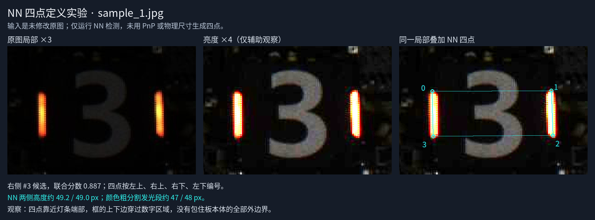

# AI 使用记录

使用工具：Codex，本轮会话系统标识为 GPT-6，历史各阶段的具体模型版本未单独记录。

## 总线

我先让 AI 通读考核方案和素材，制定项目结构与学习计划，把实施步骤对应到题目的每一点，并写入 PLAN.md。之后按模块推进，先集中搭建一个题目点需要的文件，再按小步骤学习。

每一步要求 AI 说明做了什么、涉及哪些文件、关键代码有什么作用，并运行验证。我通过代码问答、参数实验和 rqt、RViz 的实际显示检查理解情况，确认后再继续。

AI 辅助编写了检测、PnP、跟踪、旋转选板、ROS 节点、配置和工具。我主要负责确定方案、提出修改要求、回答问题和产物验收。学习问答保存在 [learning_log.md](docs/learning_log.md)，

## 项目决策

- Task3装甲板的选点：因为上一步已经做了颜色识别，方便标记一对灯条的四个端点，所以 PnP 采用定义一，即一对灯条的四个端点。尺寸最初暂用题面数值，后来改为小板 135×56 mm、大板 230×56 mm，参考 Alliance2026 开源项目。尺寸还没有与素材实物核对，继续保留临时标记。
- Task8神经网络推理：由于不确定素材提供的模型采用哪种选点定义，我让 AI 用 `assets/samples/sample_1.jpg`（从素材包 `task/nn_model.zip` 解压）做了一次临时实验，直接读取模型输出的四点并放大对照。结果四点靠近灯条上下端，围成的框没有包住板本体，更符合定义一，因此当前继续按定义一接入 PnP。这个判断来自单图输出，训练标注规范仍需提供方确认。实验代码用完后清理。

  

## 项目整理

- AI 生成的自动测试文件、临时脚本等材料，在验证或学习完成后清理。
- 原来计时、双模式拼图和预测对照写在主节点里。我要求把这些辅助功能移到 tools，主代码保留业务输出和基础可视化。
- 要求 AI 在 .cpp 文件中以函数和主要代码块为单位添加简短中文注释，说明作用，方便阅读时理解。

## 代码优化

- **位姿跳变：** 我观察到同一块装甲板持续可见、检测数量不变时，朝向仍会频繁跳变，修改尺寸后也没有解决。AI 分析可能与平面 PnP 的双解歧义、角点抖动有关，因此改为有条件的跨帧候选选择：只有时间和几何匹配有效时才使用上一帧参考，先通过正深度与重投影误差检查，再从误差接近的候选中选择旋转更接近历史的一项。历史失效时清空参考；首次解算仍可能有歧义。
- **素材入口统一：** red_4 更新后，相机话题与其他素材一致，因此清理了原来针对它的特殊处理。frame_id 保留消息原值，RViz 从 CameraInfo 自动选择坐标系。
