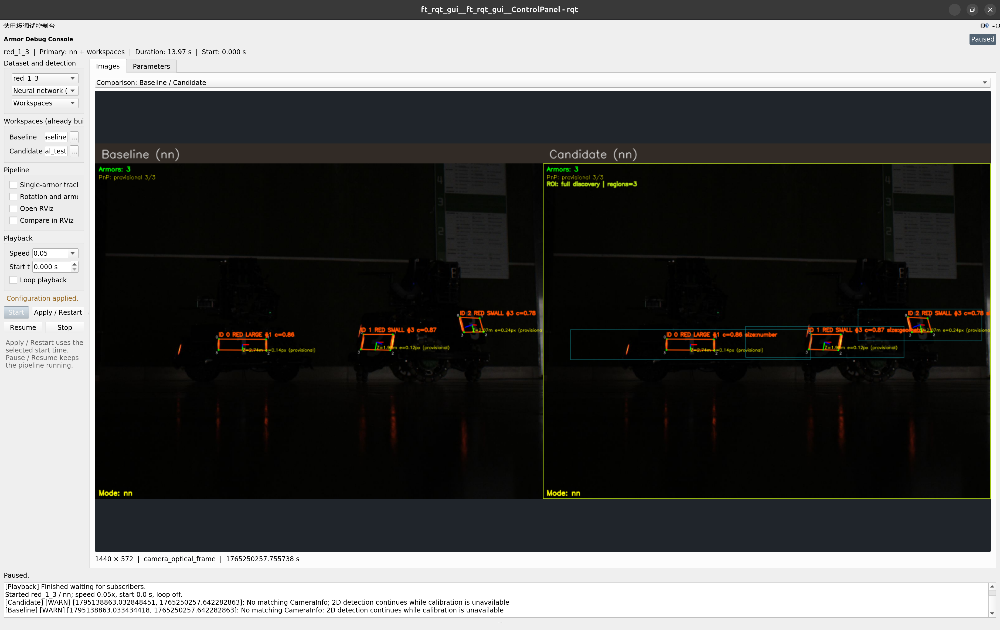
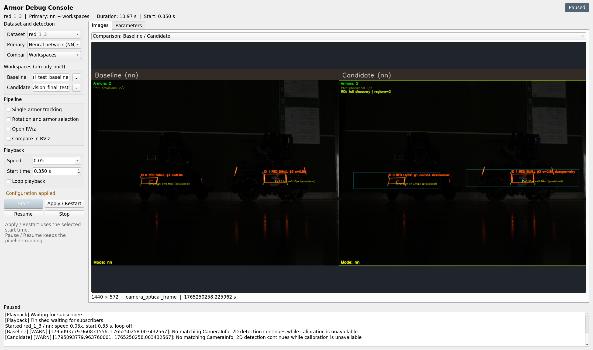
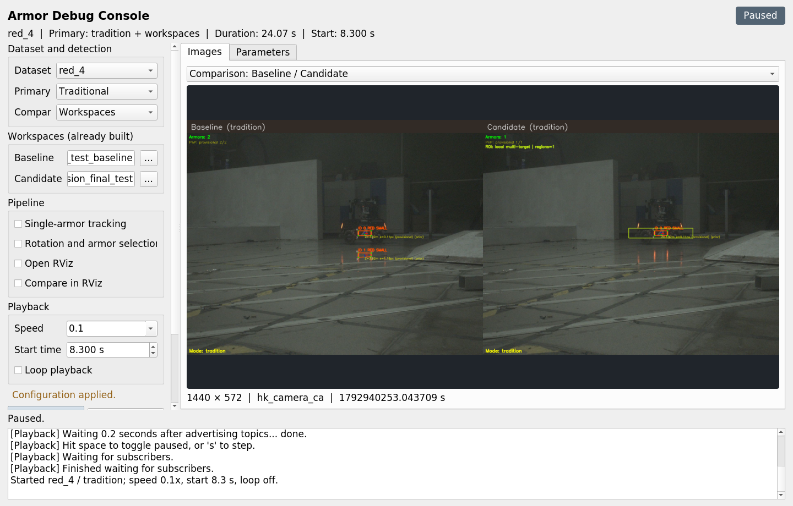

# 装甲板识别改进

## Before

原来的 NN 已经输出编号，但大小板只按灯条间距与长度之比判断。1 号大板侧向旋转时，图像中的宽度变窄，容易被判成小板，随后 PnP 会使用错误的尺寸模型。

检测每帧使用全图，ORT 和 OpenCV 都配置为 2 线程，没有针对本机寻找合适的线程组合。

传统检测也容易把地面反光的两条亮带配成装甲板。全图搜索时，这些背景区域会反复参与配对。

本轮在 `bonus/detection-improvements` 分支开发，Baseline 固定为 `1a0974e`。NN 改进编号判型、ROI 和线程配置；传统模式增加独立运行的动态 ROI。

## Change

### 编号辅助大小板

在几何判型后增加编号规则：编号最高分至少 0.8、领先第二名至少 0.1 时，1 号优先判大板，哨兵、2 号和前哨站优先判小板；3／4／5 号及两类基地仍按几何规则判断。编号不够可信时也回退几何规则。

映射与门限位于 `model.yaml` 的 `nn/number_size`，`class_sizes` 按模型九个编号类别排列：`-1` 表示几何判型，`0` 为小板，`1` 为大板。调试图用 `size:number` 或 `size:geometry` 标明依据。

动态调参中的大小板几何分界继续生效，但高置信编号覆盖几何结果时，最终板型优先遵循编号规则。

板型在 PnP 前确定，消息、TF 和跟踪使用相同结果。编号继续用于内部判型和画面显示。

### 多目标动态 ROI

参考[同济的 ROI 裁剪与偏移还原](https://github.com/TongjiSuperPower/sp_vision_25/blob/bd9f5e7/tasks/auto_aim/yolos/yolov5.cpp#L64)，在此基础上增加动态区域维护。整体逻辑是先全图发现目标，在目标周围留出余量作为后续 ROI，再根据检测与像素运动更新区域，必要时恢复全图搜索。

1. **全图发现并确认**：当前可信范围外的新目标，需要连续两次全图搜索通过确认，才建立可信区域。
2. **根据图像运动更新**：用上次检测框、估计的像素速度和图像时间差，预测下一帧区域，再加余量。这里使用的是二维像素运动，ROI 不依赖下游三维跟踪。
3. **支持多个目标**：维护多个区域，合并成一个实际裁剪窗口，每帧检测一次。
4. **漏检时恢复搜索**：短时漏检沿用预测区域，运动余量随时间增加；静止目标的区域不一定扩大。连续两帧失配后，下一帧恢复全图搜索，同时保留最多 0.5 秒的区域记忆。
5. **正常跟随也查全图**：每隔 0.2 秒图像时间搜索新目标；联合 ROI 过大时也直接使用全图。

```text
全图发现并确认 → 局部预测与检测 → 更新 ROI
      ↑                         │
      └── 定期刷新或失配恢复 ────┘
```

NN 和传统模式共用这套流程，各自独立维护区域。每个区域默认横向每侧留两个板宽、纵向每侧留半个板高，并根据像素运动增加余量。联合窗口覆盖达到全图面积的 80% 时回到全图；时间回退、长帧间隔、坐标系、分辨率或检测参数变化时清除历史。

两种模式的差别集中在候选确认和裁剪方式：

| 项目 | NN | 传统 |
|---|---|---|
| 新区域候选 | 编号分数与领先幅度达到门限 | 通过原有颜色、灯条和配对检查，不依赖 NN |
| 最小窗口 | 160×96 px，扩展为 4:3 | 64×32 px，不强制比例 |
| 局部可信范围 | 合并后的联合区域 | 各独立区域，不直接接纳区域间空白中的候选 |
| 配置位置 | `model.yaml` 的 `nn/roi` | `detector.yaml` 的 `traditional/roi` |

检测后统一恢复为原图坐标，继续使用原始 CameraInfo、消息和 TF 接口。NN 需撤销缩放、补边和 ROI 偏移；传统需还原角点、灯条及调试几何，HSV 掩膜保持原图尺寸，未搜索区域为黑色。调试图显示搜索边界、区域数量和全图／局部状态。

范围外的新目标需要搜索确认，会有发现延迟。NN 输入仍固定为 640×480，ROI 不会自动减少单次模型计算量。

ROI 限制搜索范围，不负责判断物体真假。如果反光持续通过全图确认，或本来就在可信区域内，仍可能保留，不能把 ROI 当作通用反光过滤器。

### 线程配置与独立工具

遍历容器可用的 ORT 1～24 线程，固定输入和模型，预热后以随机顺序重复三轮，穿插 2 线程基准；再测试领先配置的 OpenCV 1／2／4 线程。选择检测和 PnP 等价的实测最优组合，结果接近时优先较少的线程。

默认改为 `nn/cpu_threads: 8`、`nn/processing_threads: 2`。顶层 `processing_threads` 继续供传统模式使用，线程设置在启动时加载。

策略源码位于 `include/` 和 `src/`，由原 `ft_detector` 包编译接入；测量工具独立放在 `tools/`，业务节点不加入计时统计。模型、精度类型和现有 ROS 消息定义保持不变。

### 使用

在项目根目录、已配置的 Noetic 环境中执行：

```bash
./run.sh build
./run.sh gui
```

GUI 选择 NN、Workspaces，Baseline 选择固定版本的独立工作区，Candidate 选择当前项目。对比图左侧为 Baseline、右侧为 Candidate。

观察传统 ROI 时，将模式改为 Traditional。`model.yaml` 中 `nn/number_size/enabled`、`nn/roi/enabled` 分别控制 NN 判型和 ROI；`detector.yaml` 中 `traditional/roi/enabled` 控制传统 ROI，关闭后恢复原全图流程。修改 YAML 后点击 `Apply / Restart`；不增加 GUI 开关，也不自动保存在线参数。

复现线程测量：

```bash
source /opt/ros/noetic/setup.bash
source devel/setup.bash
cmake -S bonus/detection_improvements/tools -B build/detection_tools -DCMAKE_BUILD_TYPE=Release
cmake --build build/detection_tools --parallel 2
python3 bonus/detection_improvements/tools/tune_cpu.py \
  --project . --binary build/detection_tools/benchmark_nn \
  --output runs/nn_cpu_run_01
```

每次使用新的输出目录。工具缓存原始 JPEG 和标定，保存模型哈希、配置哈希、CPU 信息、逐帧 CSV 与汇总；这些运行数据不纳入 Git。

## After

### 侧向大板纠正

`red_1&3.bag`（GUI 名称 `red_1_3`）约 **0.530～0.711 秒**，原始帧率下连续 16 个 1 号候选，Baseline 全部判为小板，编号辅助全部纠正为大板。该项单独关闭 ROI 验证，避免把裁剪带来的变化算入板型规则。

在相邻的约 0.458～0.725 秒、23 个 1 号观测中，Baseline 有 20 次小板、3 次大板，发生一次板型切换；改进后全部为大板。使用同一套 PnP 与历史选解时，深度最大逐帧跳变量由约 0.779 m 降到 0.094 m。这是当前尺寸模型下的连续性观察，不是实物测距真值。

先看我截取的较早一帧：这时 1 号板在 Baseline 和 Candidate 中都被判为 `LARGE`。



随后 1 号板侧转，下面的实际 Qt 控制台同帧截图约在 bag 第 **0.591 秒**。左侧变为 `SMALL`，右侧仍为 `LARGE size:number`，另一块可见装甲板仍被保留。



### CPU 推理耗时

环境为 i7-14650HX、24 个可用逻辑 CPU、Noetic 容器、OpenCV 4.2.0、ORT 1.22.0 CPU。四份素材各取十张原图，共 40 张不同图像；每个配置三轮，每轮预热 20 次、循环计时 120 次，共 360 次计时。ROI 关闭，板型策略固定。

| ORT 线程 | OpenCV 线程 | 纯推理中位 ms | 纯推理 P95 ms | 检测主体中位 ms |
|---:|---:|---:|---:|---:|
| 1 | 2 | 65.18 | 66.78 | 68.21 |
| 2 | 2 | 36.20 | 37.17 | 39.26 |
| 4 | 2 | 22.13 | 22.64 | 25.27 |
| **8** | **2** | **14.72** | **15.16** | **18.04** |
| 16 | 2 | 24.62 | 25.12 | 28.66 |
| 24 | 2 | 24.18 | 36.43 | 28.08 |

8 线程的纯推理中位耗时相对 2 线程下降约 **59.3%**，约为 **2.46 倍**速度。OpenCV 1／4 线程未获得更合适的整体组合，因此保持 2。

计时分别覆盖预处理、同步 `Session::Run()` 和解码后处理。JPEG 解码、磁盘读取、PnP 等价性检查、ROS、ROI 规划和 GUI 显示不在表中；检测主体是前三项的整段用时。

本次样本中，保留检测的数量、编号、颜色、板型和帧内 ID 一致，角点差与 PnP 平移差均为 0，最大旋转数值差约 0.000002°，满足既定容差。等价性针对保留检测与 PnP，不要求被筛掉的原始候选逐值相同。该线程最优结论限定于本机和本次测试负载。

### 传统 ROI 的反光对照

我提供的地面反光截图对应 `red_4` 约第 **9.517 秒**，图像时间戳为 `1792940253.043709302 s`。固定前后各一秒，即 **8.517～10.517 秒**，按原始帧率比较，仅开关传统 ROI，其他检测和 PnP 参数保持一致。

| 连续片段，206 帧 | 全图检测 | 动态 ROI |
|---|---:|---:|
| 地面反光误检帧数 | 29 | **0** |
| 真实正面板检出帧数 | 189 | **189** |
| 真实正面板漏检帧数 | 17 | **17** |

统计对象为二维装甲板候选。17 张两侧均漏检的图像已逐张查看，真实板仍可见；ROI 没有增加该片段的漏检。189 张检出真板的时间戳一致，角点最大差约 0.00019 px。片段包含 14 次全图搜索，其中两次也检测到反光，但没有连续通过确认，因此未将反光接纳为可信区域。

下面是与我提供的截图同一图像时间戳的实际 GUI 对照。左侧 Baseline 有真板与下方反光两个框，右侧 Candidate 保留真板，搜索窗口不包含地面反光。



复现时选择 Traditional、Workspaces、`red_4`，起点设为 8.3 秒，倍率 0.1，在约 9.517 秒暂停。ROI 的结果依赖此前的观测历史，直接从误检帧启动，不能保证得到相同搜索区域。

四份素材已回归多目标、搜索恢复和坐标还原，GUI 的暂停、调参、循环和停止可用。共享组件整理前后，四份素材按 0.05 秒间隔取样的 NN 输出、区域状态与裁剪窗口一致。

我确定改进范围和验收方式，由 AI 辅助实现与验证，见 [AI 使用记录](../../ai_usage.md)。
