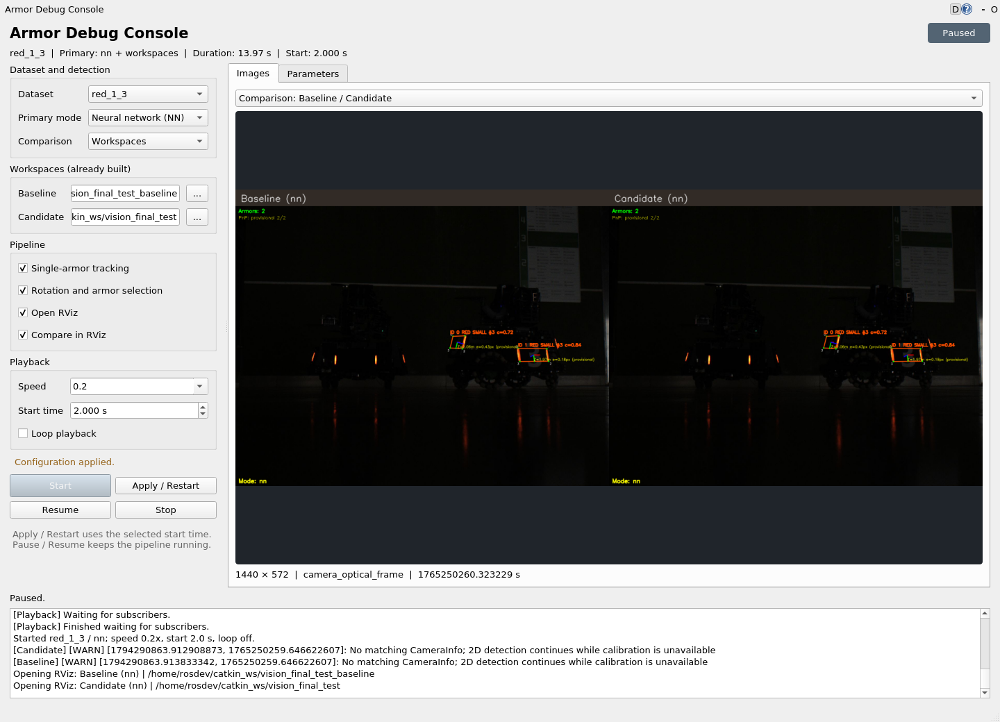
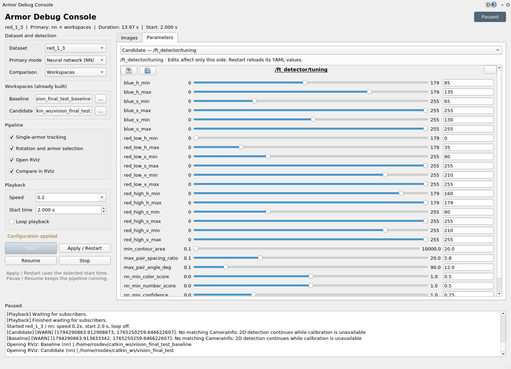
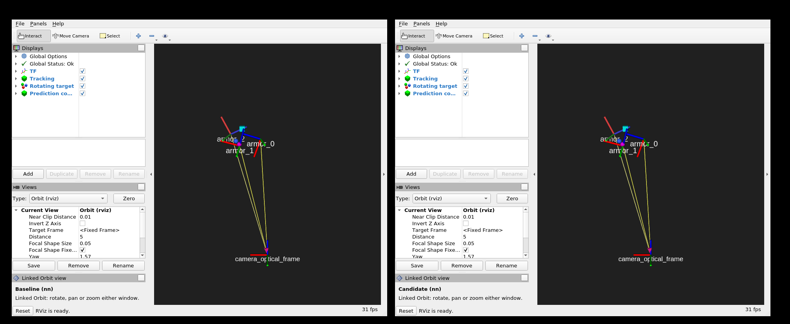

# 附加题：rqt 调试控制台

## 为什么做

命令行查看不同素材时，需要在两个终端分别启动 launch 和 bag。切换素材、模式、倍率或对比功能需要停止进程并重新输入命令；图像、参数和 RViz 也分散在不同窗口，操作比较麻烦。

算法版本对比需要让基线和改进版本使用同一份素材，分别查看识别、跟踪和预测结果，并联动两个 RViz 的视角，方便对照。

因此选择开发 rqt GUI，把运行控制、图像和参数编辑集中到一个窗口，复用现有 ROS 节点与调参控件，RViz 保持独立窗口。

## 做了什么

### 运行控制和两种对比

控制台使用英文界面，可以选择素材、识别模式、跟踪与选板开关，以及回放倍率、起点和循环。启动、停止、暂停、继续和应用配置都在界面里完成。

`Comparison` 提供三种运行方式，每次最多运行两条链路：

| 选项 | 运行内容 | 拼图顺序 |
|---|---|---|
| Off | 所选识别模式的单路链路 | 无拼图 |
| Detection modes | 同一版本的传统与 NN 链路 | 左 Traditional，右 NN |
| Workspaces | 两个已构建工作区的完整链路 | 左 Baseline，右 Candidate |

版本对比两侧统一使用所选 Traditional／NN 模式，共用数据、回放起点和功能开关，算法与 YAML 配置分别来自各自工作区。

`Images` 页可以查看原图、任意一侧的检测图或同帧拼图，暂停后也能切换图源。拼图只匹配图像时间戳一致的两张图。

旋转选板开启时自动增加 `prediction overlay` 和 `Prediction comparison` 图源，无独立开关。新版显示当前模型板与未来板四边形；旧版缺少完整板姿态时只显示预测中心，并标注 center only。关闭选板时一并停止投影工具。未来板画在当前图像上；T 秒后的实际对照单独测试，不放入 GUI。



`Parameters` 页先选择运行侧，再通过 `Detection`、`Linear tracking`、`Rotating tracking` 切换模块。关闭的业务模块不显示。检测页按该侧实际模式过滤字段，Traditional 显示 HSV 和几何筛选，NN 显示分数、NMS 与大小板分界，避免调到当前模式没有使用的参数。

| 模块 | 在线调整内容 |
|---|---|
| Detection | 传统颜色与灯条几何、NN 四项筛选阈值、共用的大小板分界 |
| Linear tracking | Q 噪声密度、R 位置方差、位置关联门限 |
| Rotating tracking | 平移与角运动噪声、位置与角度观测方差、位置与角度关联门限、换板代价优势和冷却时间 |

上方的 `Prediction horizon T` 统一修改所选侧已开启的线性和旋转预测，完成输入后生效；`Reset T` 恢复该侧启动 YAML 中的提前量。T 更新失败时尝试恢复旧值，无法确认恢复时提示重启。两种滤波器调整 Q/R 和关联门限时保留当前轨迹与 ID。

参数编辑继续复用 rqt_reconfigure 控件，不自动写回 YAML，重启后重新加载配置。bag 暂停时也能改参数，收到下一张图像后才能看到画面变化。旧 Baseline 可以继续运行和调整原有检测字段；没有提供在线服务的模块会显示说明，无法完整联动时禁用 T 控件。

旋转模块中的 `switch_cost_margin` 调整换板所需的代价优势，`switch_cooldown_s` 调整图像时间下的冷却时长。推荐值为 0.01、0.02 s；旧 Baseline 不支持时不显示这两项。在线修改保留当前轨迹和原冷却起点，`Set to Default` 恢复该侧启动 YAML 中的值。



### 双 RViz 联动

勾选 `Compare in RViz` 后，打开两个标明模式或版本的 RViz，分别显示对应的 TF、平移跟踪、旋转选板和预测对照。

两窗共用一个播放器，播放、暂停和循环统一控制。Orbit 插件同步角度、焦点和距离，在任意一窗旋转、平移或缩放，另一窗都会跟随。同步使用实际时间，bag 暂停后仍可操作。



### 实现与验证

源码集中在 `ft_rqt_gui/`，通过项目中的 `src/ft_rqt_gui` 相对符号链接接入 catkin。调用关系为：

```text
控制台 → 会话检查 → 分别加载工作区环境 → 业务节点就绪
                                      ↓
                               一个 bag 播放器
                                      ↓
                         图像、参数页和独立 RViz
```

我负责确定功能、界面语言和版本准备方式，AI 辅助实现界面、进程管理、视角同步和验证。具体记录见 [ai_usage.md](../../ai_usage.md)。

使用限制：

- 视角联动只支持 Orbit，固定在共同相机坐标系下；切到其他视图时暂停同步，切回 Orbit 后恢复。
- 共同回放不保证两个 RViz 每个瞬间都显示同一时间的处理结果，可暂停后结合消息时间戳观察。
- 图像最高以 15 Hz 显示，每个图源只缓存最近一帧；两条完整链路会增加 CPU 和内存占用。
- 对比工作区需保留本项目的启动接口及兼容消息，GUI 不负责 Git 操作或编译。
- 不支持拖动时间轴、逐帧跳转、无缝变速、自动调参、badcase 管理或算法评分。工具不自动判断哪一版算法更好，需结合具体片段和指标对照。

## 使用方法

### 构建与启动

在项目根目录、已配置的 Noetic 环境中执行：

```bash
./run.sh build
./run.sh gui
```

GUI 和 RViz 需要可用的图形环境。完整依赖见 [package.xml](ft_rqt_gui/package.xml)。修改 Python 文件后重新打开即可；修改 Orbit 插件的 C++ 文件后需要重新构建。

没有 ROS master 时，启动器创建并管理一个；已有 master 时直接复用，退出后保留它。

### 日常操作

1. 选择 `Dataset` 和 `Primary mode`。默认 blue_1、Traditional、0.2 倍、0 秒起点、不循环，跟踪与选板均开启。
2. 选择 `Comparison`。使用 Workspaces 时，填写已构建的 Baseline、Candidate 工作区目录。
3. 设置倍率、起点和循环。需要单窗 RViz 时勾选 `Open RViz`；需要双窗联动时勾选 `Compare in RViz`，它会自动开启 Open RViz。
4. 点击 `Start`，在 Images 页切换图源，在 Parameters 页选择运行侧和模块。默认调参对象为正式模式或 Candidate；调整传统检测时选择 Traditional 侧，与主运行模式无关。
5. 使用 `Pause` / `Resume` 暂停或继续。修改运行配置后，点击 `Apply / Restart` 从设定起点重启；在线参数修改则即时生效，重启后恢复各自的 YAML 配置。
6. 点击 `Stop` 结束会话。非循环回放结束后保留最后画面和业务节点；关闭 GUI 或手动关闭任一 RViz 窗口，也会回收该会话。停止和关闭时会等待自有进程退出。

### 准备跨版本对比

准备两个独立构建的工作区，分别作为 Baseline 和 Candidate。基线不需要安装 GUI 包。

首次准备时，先在**宿主机项目根目录**创建基于主分支的 worktree，并共享现有素材、模型和依赖：

```bash
git worktree add --detach ../vision_final_test_baseline vision-final-test
ln -s ../vision_final_test/task ../vision_final_test_baseline/task
ln -s ../vision_final_test/assets ../vision_final_test_baseline/assets
ln -s ../vision_final_test/.deps ../vision_final_test_baseline/.deps
```

然后在 Noetic 环境中分别进入两个目录执行 `./run.sh build`，各自生成 build 和 devel。两个目录都要位于容器可访问的挂载范围内；GUI 里的路径按其运行环境填写，例如容器中是 `/home/rosdev/catkin_ws/vision_final_test_baseline`。

比较算法改动前，先点击 Stop，在 Candidate 中改代码并重新构建，再从 GUI 启动对比。基线保持不动；需要更换基线时，在 GUI 外准备并构建另一个工作区，再选择其目录。

未提交的代码也可比较，但需要先完成对应构建。界面中的路径标明工作区位置，不代表工具已经核实源码与编译产物完全一致。两侧各用自己的 YAML 和模型，因此参数或模型改动也会影响对比结果。
