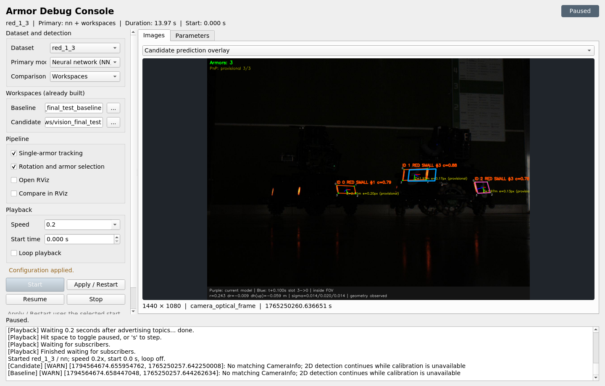
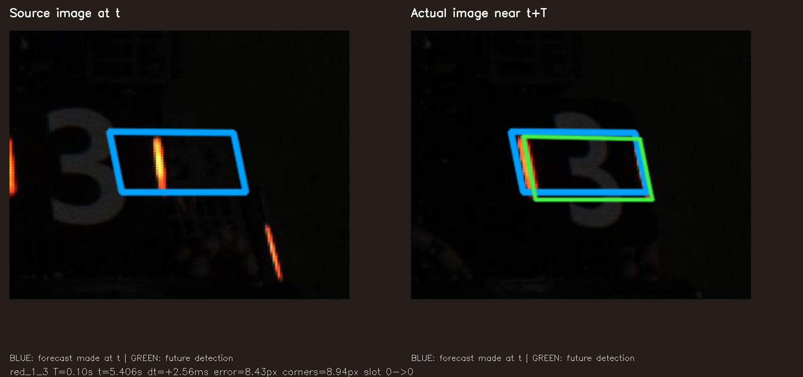
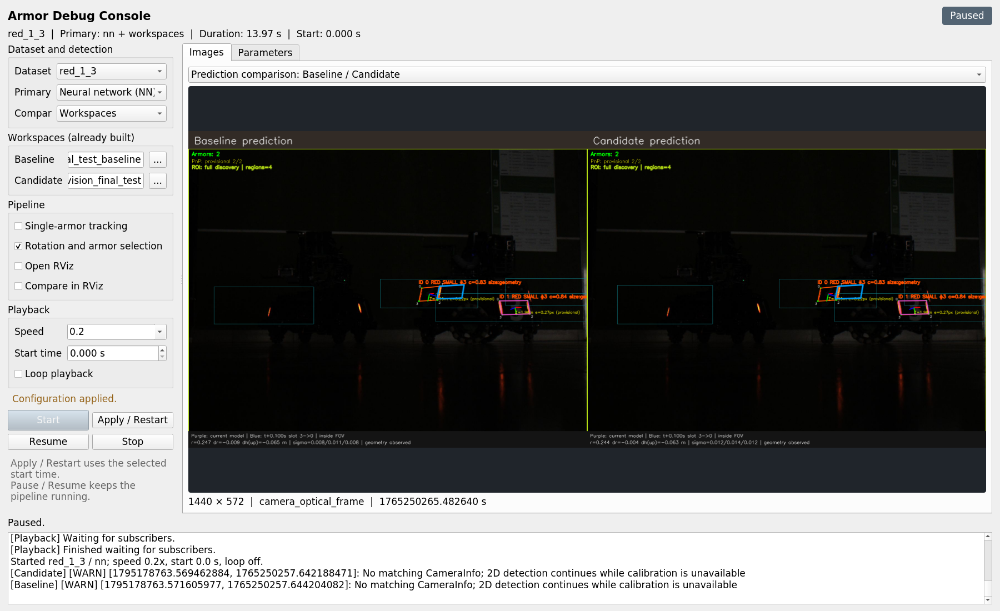

# 旋转预测改进

## Before

原来的旋转模型使用八维状态 `[cx,cy,cz,vx,vy,vz,θ,ω]`，半径由 YAML 固定为 0.25 m，所有装甲板处于同一高度。它可以预测旋转和换板，但不能根据观测调整车辆半径，也无法描述两组装甲板的高度差。

只在 RViz 中显示三维中心点时，不容易直接判断预测板在图像中的位置、大小和朝向；画在当前图像上的未来位置，也不能直接说明 T 秒后的预测是否准确。

几何估计与重投影的对照基线为 `be476e0`。版本效果通过 GUI 的 Workspaces 对比观察，T 秒后的误差单独测量。

固定 R 对所有装甲板使用相同的位置和角度方差，不能区分距离、朝向、重投影误差和分数不同的观测。观测质量加权的对照基线为 `582c0fd`。

## Change

### 半径与两组高度差

参考[同济 sp_vision_25 的车辆状态与两组几何建模](https://github.com/TongjiSuperPower/sp_vision_25/blob/bd9f5e7/tasks/auto_aim/target.cpp)，将状态扩展为十一维：

```text
[cx, cy, cz, vx, vy, vz, θ, ω, r, Δr, Δh]
```

| 槽位 | 半径 | 板中心的相机 Y 坐标 |
|---|---|---|
| 0、2 | r | cy |
| 1、3 | r + Δr | cy − Δh |

Δh 是两组装甲板中心的高度差，不是装甲板本身的高度。相机 Y 向下，Δh 为正表示奇数组比偶数组高；cy 是偶数组板中心的高度参考。

EKF 通过连续的位置和朝向观测估计这三个几何量。半径 0.25 m 作为初值，半径差和高度差从零开始。两组半径限制在 0.05～0.50 m，|Δh|≤0.20 m，越界的校正整组拒绝。转角、观测数量和两组覆盖不足时显示 `geometry warming up`；完成覆盖也不代表几何已经准确标定。两板、三板模式只估计共同半径。

### 预测板重投影

从当前与未来板的三维中心、朝向构造灯条四端点，再用 CameraInfo 的内参与畸变投影回图像。物理尺寸沿用当前 PnP 配置，没有重新定义一套尺寸。

- 紫色四边形：当前模型板。
- 蓝色四边形：t+T 时刻选中的预测板，可能属于另一槽位。
- 旧 Baseline 没有完整板姿态时，只显示黄色预测中心，不补造四角。

投影作为独立工具运行，随选板自动启停。图像页可查看单侧或 Baseline / Candidate 拼图。四边形叠在源时刻 t 的图像上，另行检查正深度、出界和边缘余量；这些检查不能判断实际遮挡。



### 按观测质量调整 R

采用可解释的规则加权。每块内部 `ArmorObservation` 包含 x、y、z、yaw 四个方差倍率，默认全为 1；初始化和校正时，基础方差乘以当前观测的倍率。十一维状态、Q、关联门限、每帧一次校正和预测板投影保持一致。

| 质量信息 | 计算方式 |
|---|---|
| 重投影误差 e | 用已发布 Pose、四角点、同侧 CameraInfo 和 PnP 尺寸重新投影，计算四点 RMS；不重新求解 PnP |
| 置信度 c | 直接读取 Detection.confidence，NN 和传统分别设参考值，不当作标定概率 |
| 距离 d | 板中心到相机的三维距离 |
| 朝向 f | 板朝外法向与指向相机方向的余弦；正视接近 1，侧视接近 0 |

```text
b = [1 + (e / e₀)²] × max(1, c₀ / max(c, 0.2))²
u = max(1, d / d₀)
位置侧向因子 = 1 + 2 × (1 − f²)
角度正视因子 = 1 + f²
raw_x、raw_y = b × u² × 位置侧向因子
raw_z       = b × u⁴ × 位置侧向因子
raw_yaw     = b × u² × 角度正视因子
最终倍率 = clamp[1 + λ × (raw − 1), 1, 25]
```

较远、较侧向的板增加位置不确定度；正视时增加平面姿态角歧义对应的角度方差。这是启发式倍率，不是真实协方差，也不能识别重投影误差同样很小的错误 PnP 分支。

`selector.yaml` 的 `observation_noise` 配置参考值和强度。e₀=1 px、d₀=3 m，NN 的 c₀=0.8，传统为 0.85。默认位置、角度强度分别为 NN `(1, 2)`、传统 `(1, 1)`。

原有 `position_variance`、`yaw_variance` 滑块继续调整基础方差，在线修改保留轨迹、ID、状态和协方差。缺少匹配标定、有效尺寸或必要质量信息时，本块观测回退固定 R，仍参与原有跟踪。ROS 消息定义保持不变。

### 文件与运行

```text
rotation_prediction/
├── README.md
├── ft_selector/               # 十一维旋转 EKF、选板和 ROS 节点
├── tools/
│   └── reproject_predictions.py # 独立重投影工具
└── images/                    # 实际运行截图、T 秒后的对照图
```

`src/ft_selector` 是指向这里算法包的相对链接。`PredictionDebug.msg` 位于 `src/ft_msgs/msg/`，启动入口、几何参数和 PnP 尺寸由 `src/ft_bringup/` 管理；Detection、Track、Target 消息保持兼容。

在项目根目录、已配置的 Noetic 环境中执行：

```bash
./run.sh build
./run.sh gui
```

GUI 选择 `Workspaces`，Baseline 选择已独立构建的改进前工作区，Candidate 选择当前项目；两侧统一使用 NN 并开启旋转选板。具体操作见 [GUI 说明](../gui/README.md)。命令行运行：

```bash
./run.sh launch dataset:=red_1_3 mode:=nn
./run.sh play red_1_3 -r 0.2
```

检测图为 `/ft/debug/image`，预测图为 `/ft/debug/prediction_image`。`/ft/debug/rotation_prediction` 保存同次预测使用的源时间、未来时间、T、板位姿和几何状态。

AI 在算法、投影工具及延迟对照中的辅助范围见 [AI 使用记录](../../ai_usage.md)。

## After

### 实际观察

我在同一份素材的 Baseline / Candidate 对比中观察到：

| 素材 | 观察结果 |
|---|---|
| red_1_3 | 提升比较明显，这段两组板的高度差较明显，改进后可以表现不同高度的板。 |
| red_4、blue_1 | 预测效果正常。 |
| blue_guard | 预测效果较差，相机运动对当前模型影响明显。 |

下图为 red_1_3 的同帧对照，左 Baseline、右 Candidate，展示高度差与预测位置的视觉差异。


### T 秒后的观测对照

将 t 时刻保存的预测与 t+T 附近的同轨迹、同槽位检测比较。NN 短片段的结果为：

- red_1_3：T=0.1 s、0.2 s 的中心中位误差分别约 8.43 px、15.51 px，提前量增大后误差更明显。
- blue_1：对应中位误差约 15.74 px、39.39 px，部分样本偏差较大，预测仍有不稳定情况。

蓝框为先前保存的预测，绿框为后续实际检测。参考来自检测结果，并非独立真值；以上只统计成功匹配的样本，不能代表全段准确率或两个版本的提升幅度。




较大偏差的例子见 [red_1_3](images/red_1_3_T_200_largest_error.png) 和 [blue_1](images/blue_1_T_200_largest_error.png)。

### 观测质量加权的留出对照

对照复用同一份缓存检测与标定，固定检测、ROI、Q、关联参数和提前量，只比较观测噪声。两种模式共 30,904 帧；用内部全 1 倍率建立固定 R 参考时，旋转状态、几何及两种提前量的预测与 `582c0fd` 逐帧一致。

`red_1_3`、`blue_1`、`red_4` 各以前半段选择参数、后半段留出对照，模型从 bag 开头按原始帧率连续推进。位置和角度强度分别遍历 `{0, 0.5, 1, 2}`，非零组合未能同时保持两种提前量的所有误差与覆盖指标不退化。以下结果使用 NN `(1, 2)`、传统 `(1, 1)`，改善并不覆盖所有模式和片段。

下面汇总三份素材的后半段，误差在两侧共同可比的未来参考样本上统计，单位为未来图像上的中心投影误差：

| 模式 | T (s) | 共同样本数 | 中位 px：固定→加权 | P95 px：固定→加权 |
|---|---:|---:|---:|---:|
| NN | 0.1 | 5287 | 10.69 → **6.41** | 244.25 → **240.63** |
| NN | 0.2 | 5267 | 21.47 → **13.49** | 256.67 → **247.25** |
| 传统 | 0.1 | 1620 | 11.23 → 13.54 | 70.98 → 107.07 |
| 传统 | 0.2 | 1489 | 27.76 → 28.82 | 278.72 → 251.34 |

覆盖率单独检查，不能只看成功配对的误差：

| 模式 | T (s) | 可评价源帧 | 有效预测：固定→加权 | 固定 R 原有参考中失去共同配对 |
|---|---:|---:|---:|---:|
| NN | 0.1 | 5386 | 5304 → 5304 | 0 / 5287 |
| NN | 0.2 | 5382 | 5300 → 5300 | 0 / 5267 |
| 传统 | 0.1 | 5386 | 2581 → 3453 | 257 / 1877 |
| 传统 | 0.2 | 5382 | 2587 → 3444 | 165 / 1654 |

当前观测匹配计数与有效预测计数相同。NN 的三维中心误差中位数由约 0.122→0.114 m、0.266→0.224 m；传统虽然有效预测增多，但共同参考配对减少，误差改善也不一致，因此不能据此认为整体精度提高。

未来参考来自同一缓存中的检测，不是独立真值。用固定 R 的共同车体关联和未来观测的朝向选取参考板，不按哪一个预测点更近来挑参考。预测中心和参考中心用未来帧的标定投影；时间匹配采用最近图像，容差为 `max(5 ms, 0.75 × 中位帧间隔)`，源帧与未来帧须在同一半段。误差表只统计成功配对，覆盖率另列，不能当作全段真实精度。

改善没有覆盖所有片段。NN 的 `red_4` 后半段，T=0.1 s 的中位误差由 9.46→9.94 px，P95 由 68.21→124.63 px；T=0.2 s 的 P95 由 158.91→179.22 px。`red_1_3` 的 T=0.2 s P95 也由 310.89→322.34 px，汇总改善主要来自 `blue_1`。

`blue_guard` 单独作为运动相机边界检查，未参与参数选择。NN 后半段 T=0.1 s 的中位误差约 120.59→108.87 px，P95 约 212.87→199.36 px，仍明显较大；规则没有补偿相机运动，稳定相机假设仍是限制。

换板与平滑程度也没有统一改善：NN 的 `blue_1` 后半段，同轨迹相邻已匹配帧的观测槽位变化次数从 156→286；`red_4` 从 48→46。只在双方匹配到同一检测、各自槽位连续的片段计算位置二阶差分，`red_4` 的粗糙度中位数约为 55.08→48.72 m/s²；这只是输出变化的代理量，不是纯噪声真值。其 18.45～24.06 秒连续片段，在 10 ms 网格下相对观测 X 的最佳对齐偏移两侧均为 0，不能据此排除更小或其他片段上的响应滞后。

下面是实际 GUI 在 `red_1_3` 约第 7.85 秒的同帧对照，左侧固定 R，右侧使用 NN 试验强度 `(1, 2)`。蓝框仍画在源时刻图像上；截图展示预测和换板差异，T 秒后的观察以上面的缓存对照为依据。



复现时，两个工作区使用同一份素材和 NN 模式，Baseline 保持 `582c0fd`，Candidate 使用当前配置；从 0 秒、0.2 倍率播放，开启旋转选板并查看预测对比图。单独启动选板时，也可用 `camera_info_topic:=...` 指定相机入口。

缺标定、坐标系不匹配、非法标定和缺置信度的在线检查各覆盖 100 帧，均回退到与固定 R 相同的预测。GUI 接入检查覆盖两种主模式、旧 Baseline 对比、倍率边界和在线基础 R 更新。

### 限制与后续方向

当前模型假设相机稳定、旋转轴近似相机 Y 方向，并沿用同车共同的板型与安装倾角。半径与高度差由观测估计，不代表已完成实物标定；突然变速、观测角度不足、PnP 抖动、遮挡和错误关联也会影响结果。

blue_guard 的相机运动明显，不满足稳定相机假设。未做补偿时，相机运动和车辆运动混在一起，因此将它作为失效样例。


后续优先考虑使用相机位姿变换，在稳定参考系中跟踪，再将未来板变换回对应时刻的相机系投影。
