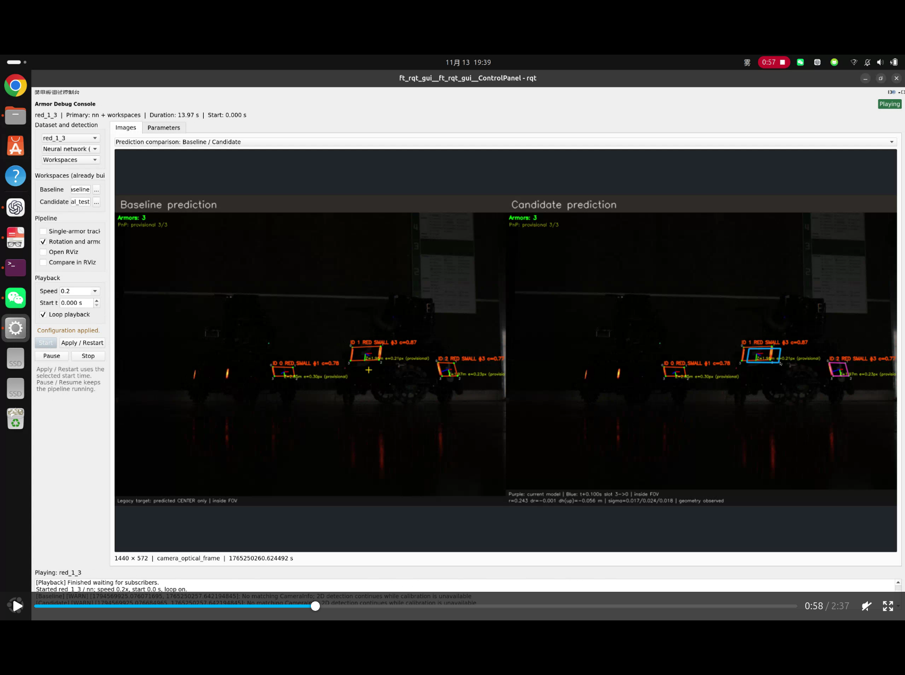
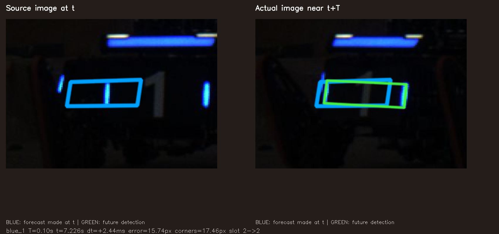
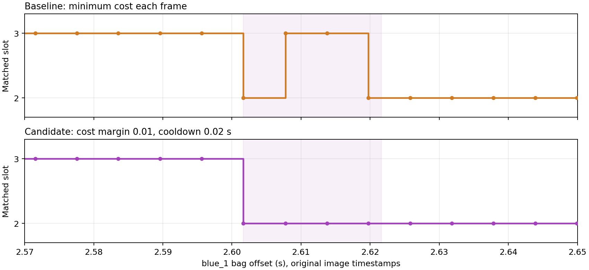
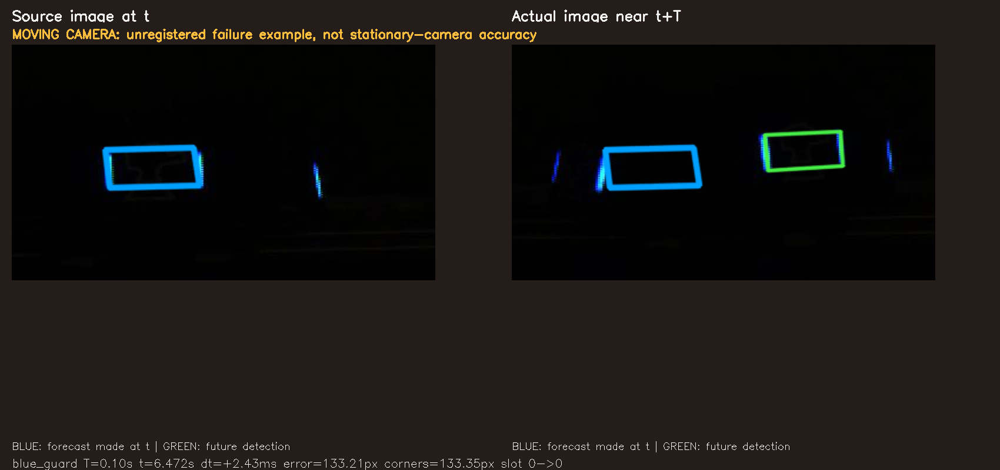

# 旋转预测改进

## Before

原来的旋转模型使用八维状态 `[cx,cy,cz,vx,vy,vz,θ,ω]`，半径由 YAML 固定为 0.25 m，所有装甲板处于同一高度。它可以预测旋转和换板，但不能根据观测调整车辆半径，也无法描述两组装甲板的高度差。

只在 RViz 中显示三维中心点时，不容易直接判断预测板在图像中的位置、大小和朝向；画在当前图像上的未来位置，也不能直接说明 T 秒后的预测是否准确。

几何估计与重投影的对照基线为 `be476e0`。版本效果通过 GUI 的 Workspaces 对比观察，T 秒后的误差单独测量。

当前观测板按每帧最低关联代价选择。两块板同时可见、代价接近时，小幅位置和朝向噪声就可能使匹配槽位反复变化，表现为紫红色当前模型框来回换板。选板保持的对照基线为 `582c0fd`，两侧均使用固定 R。

## Change

### 半径与两组高度差

参考[同济 sp_vision_25 的车辆状态与两组几何建模](https://github.com/TongjiSuperPower/sp_vision_25/blob/bd9f5e7/tasks/auto_aim/target.cpp)，将状态扩展为十一维：

```text
[cx, cy, cz, vx, vy, vz, θ, ω, r, Δr, Δh]
```

| 槽位 | 半径 | 板中心的相机 Y 坐标 |
|---|---|---|
| 0、2 | r | cy |
| 1、3 | r + Δr | cy − Δh |

Δh 是两组装甲板中心的高度差，不是装甲板本身的高度。相机 Y 向下，Δh 为正表示奇数组比偶数组高；cy 是偶数组板中心的高度参考。

EKF 通过连续的位置和朝向观测估计这三个几何量。半径 0.25 m 作为初值，半径差和高度差从零开始。两组半径限制在 0.05～0.50 m，|Δh|≤0.20 m，越界的校正整组拒绝。转角、观测数量和两组覆盖不足时显示 `geometry warming up`；完成覆盖也不代表几何已经准确标定。两板、三板模式只估计共同半径。

### 预测板重投影

从当前与未来板的三维中心、朝向构造灯条四端点，再用 CameraInfo 的内参与畸变投影回图像。物理尺寸沿用当前 PnP 配置，没有重新定义一套尺寸。

- 紫色四边形：当前模型板。
- 蓝色四边形：t+T 时刻选中的预测板，可能属于另一槽位。
- 旧 Baseline 没有完整板姿态时，只显示黄色预测中心，不补造四角。

投影作为独立工具运行，随选板自动启停。图像页可查看单侧或 Baseline / Candidate 拼图。四边形叠在源时刻 t 的图像上，另行检查正深度、出界和边缘余量；这些检查不能判断实际遮挡。


### 当前板保持与换板冷却

每帧先保留各模型槽位的最佳合法观测，再决定是否换板。原有颜色、位置和角度门限继续生效，保持依据是模型槽位，不是帧内 Detection.id。

| 情况 | 处理 |
|---|---|
| 当前槽位有合法观测，仍在冷却期 | 继续用当前板校正 |
| 冷却结束，其他板只有很小优势 | 保持当前板 |
| 冷却结束，其他板明显更好 | 换板，成功校正后重新计时 |
| 当前槽位失配，其他槽位有合法观测 | 绕过冷却，同帧尝试正常换板 |
| 所有槽位均失配 | 只预测，沿用原失联处理 |

代价仍是归一化位置误差与角度误差的平方和。新板须满足 `新板代价 + cost_margin < 当前板代价`，才算明显更好。

推荐启动配置位于 `selector.yaml`：

```yaml
association_hysteresis:
  cost_margin: 0.01
  cooldown_s: 0.02
```

运行时在 GUI 的 `Parameters` 页选择运行侧和 `Rotating tracking`，或在 rqt_reconfigure 中选择该侧的 `/ft_selector/tuning`：

| 动态字段 | 含义 | 范围 |
|---|---|---|
| `switch_cost_margin` | 换板所需的绝对代价优势，越大越倾向保持当前板 | 0～2 |
| `switch_cooldown_s` | 换板后的冷却时间，单位为图像秒 | 0～1 s |

滑块和数值输入框都可使用，精细数值可直接输入。修改从下一帧参与决策，保留轨迹 ID、状态、协方差、当前槽位和冷却起点；冷却时间按新值和原起点计算。暂停时也能调参，收到下一帧后才反映效果。`Set to Default` 恢复启动 YAML 的值，在线修改不写回 YAML，重启重新加载；旧 Baseline 的参数页不显示它没有提供的字段。

冷却使用图像时间，初始化及成功换板时开始计时。暂停不消耗冷却时间；冷却期间仍正常校正，不制造空帧。校正失败不更新槽位和冷却起点，每帧至多校正一次。时间倒退、轨迹重建和重置会清理保持状态，在线调整 Q/R 不清空它。

两项参数必须有限且非负，同时设为 0 时恢复原始最低代价规则及平局顺序。ROS 消息与 GUI 对比接口保持兼容。保持机制只改变当前板关联，未来板仍按预测时刻的朝向选择。

### 文件与运行

```text
rotation_prediction/
├── README.md
├── ft_selector/               # 十一维旋转 EKF、选板和 ROS 节点
├── tools/
│   └── reproject_predictions.py # 独立重投影工具
└── images/                    # 实际运行截图、T 秒后的对照图
```

`src/ft_selector` 是指向这里算法包的相对链接。`PredictionDebug.msg` 位于 `src/ft_msgs/msg/`，启动入口、几何参数和 PnP 尺寸由 `src/ft_bringup/` 管理；Detection、Track、Target 消息保持兼容。

在项目根目录、已配置的 Noetic 环境中执行：

```bash
./run.sh build
./run.sh gui
```

GUI 选择 `Workspaces`，Baseline 选择已独立构建的改进前工作区，Candidate 选择当前项目；两侧统一使用 NN 并开启旋转选板。具体操作见 [GUI 说明](../gui/README.md)。命令行运行：

```bash
./run.sh launch dataset:=red_1_3 mode:=nn
./run.sh play red_1_3 -r 0.2
```

检测图为 `/ft/debug/image`，预测图为 `/ft/debug/prediction_image`。`/ft/debug/rotation_prediction` 保存同次预测使用的源时间、未来时间、T、板位姿和几何状态。

AI 在算法、投影工具及延迟对照中的辅助范围见 [AI 使用记录](../../ai_usage.md)。

## After

### 实际观察

我在同一份素材的 Baseline / Candidate 对比中观察到：

| 素材 | 观察结果 |
|---|---|
| red_1_3 | 提升比较明显，这段两组板的高度差较明显，改进后可以表现不同高度的板。 |
| red_4、blue_1 | 预测效果正常。 |
| blue_guard | 预测效果较差，相机运动对当前模型影响明显。 |

下图为 red_1_3 的同帧对照，左 Baseline、右 Candidate，展示高度差与预测位置的视觉差异。



### T 秒后的观测对照

将 t 时刻保存的预测与 t+T 附近的同轨迹、同槽位检测比较。NN 短片段的结果为：

- red_1_3：T=0.1 s、0.2 s 的中心中位误差分别约 8.43 px、15.51 px，提前量增大后误差更明显。
- blue_1：对应中位误差约 15.74 px、39.39 px，部分样本偏差较大，预测仍有不稳定情况。

蓝框为先前保存的预测，绿框为后续实际检测。参考来自检测结果，并非独立真值；以上只统计成功匹配的样本，不能代表全段准确率或两个版本的提升幅度。




较大偏差的例子见 [red_1_3](images/red_1_3_T_200_largest_error.png) 和 [blue_1](images/blue_1_T_200_largest_error.png)。

### 选板保持的连续片段对照

对照复用相同检测缓存，固定识别、ROI、PnP、Q/R 和关联门限，按原始图像时间逐帧推进。四份素材、两种模式共 30,904 帧；两项保持参数均为 0 时，输出及状态、协方差哈希与 Baseline 完全一致。

往返定义为：同一车体轨迹连续匹配时，从 A 槽位切到 B，再在 0.1 秒内回到 A。相同槽位的连续帧合并为一段，漏匹配和轨迹重建中断统计。这个数量用于检查短时往返，不把所有正常换板都当作错误。

| blue_1，NN | 帧数 | 往返：Baseline → 保持 | 有效匹配：Baseline → 保持 |
|---|---:|---:|---:|
| 2.5～5.5 s | 477 | 10 → **4** | 477 → 477 |
| 后半段 | 3639 | 110 → **23** | 3557 → 3557 |
| 全段 | 7224 | 306 → **98** | 7141 → 7141 |

目标窗口中，两次换板时原槽位都仍有合法观测的往返由 8 次降到 4 次。约 2.596～2.620 秒，Baseline 出现 `3→2→3→2`，保持机制为 `3→2`。下图浅色区为该次换板后的 20 ms 冷却区间。



其余三份素材的 NN 全段往返次数分别为：red_1_3 的 72→17、red_4 的 51→29、blue_guard 的 30→4。传统模式中，前三份素材均为 0→0，blue_guard 为 8→2。两种模式、四份素材的有效匹配时间戳均与 Baseline 一致，没有用额外漏匹配换取往返减少。

blue_1 的推荐配置中，持续更优的新板因冷却产生的 41 次等待，最长约 24.1 ms，包含离散帧间隔；当前板失配时有 36 次同帧成功换板，没有额外等待冷却。受控检查也覆盖了冷却边界、校正拒绝、空帧、时间倒退、超时和在线 Q/R 调整。

初始 `0.10 / 0.10 s` 的保持较强：虽然目标窗口往返降到 0，但 blue_1 在约 0.751～1.451 秒少匹配 99 帧，出现合法关联后的几何校正拒绝，预测中位误差也增大。因此使用更温和的 `0.01 / 0.02 s` 作为推荐配置。

### 保持机制对未来预测的影响

未来参考取自同一缓存中的后续检测，按 Baseline 的车体关联和未来观测朝向选择参考板，不按哪个预测点更近来挑参考。以最近图像匹配 t+T，容差为 `max(5 ms, 0.75×中位帧间隔)`；源帧与未来帧须属于同一半段，预测中心和参考中心投影到未来图像。它是观测对照，不是独立真值。

blue_1 后半段的共同参考结果如下，推荐配置没有减少参考配对数：

| T (s) | 共同样本 | 中位 px：Baseline → 保持 | P95 px：Baseline → 保持 |
|---|---:|---:|---:|
| 0.1 | 3525 | 11.12 → **9.50** | 245.27 → 244.94 |
| 0.2 | 3491 | 20.31 → **16.86** | 256.67 → 256.78 |

这说明保持机制减少了目标片段中的反复切换，但不能据此认为所有预测都更准。red_1_3 后半段 T=0.2 s 的中位误差为 26.90→27.79 px、P95 为 310.89→314.10 px；red_4 对应 P95 为 158.91→163.96 px。blue_1 的大误差尾部也仍然存在。

### 限制与后续方向

当前板保持只处理匹配代价竞争，不能消除同一槽位的 PnP 姿态抖动，也不限制未来板在朝向临界处正常切换。当前板失配时会绕过保持，因此短时往返不会全部消失。

当前模型假设相机稳定、旋转轴近似相机 Y 方向，并沿用同车共同的板型与安装倾角。半径与高度差由观测估计，不代表已完成实物标定；突然变速、观测角度不足、PnP 抖动、遮挡和错误关联也会影响结果。

blue_guard 的相机运动明显，不满足稳定相机假设。未做补偿时，相机运动和车辆运动混在一起，因此将它作为失效样例。



后续优先考虑使用相机位姿变换，在稳定参考系中跟踪，再将未来板变换回对应时刻的相机系投影。
