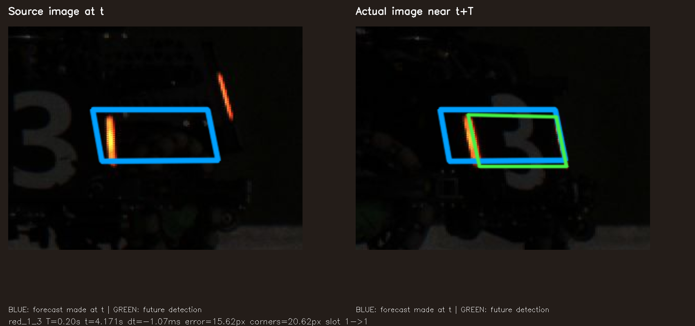

# 旋转预测改进

## Before

原来的旋转模型使用八维状态 `[cx,cy,cz,vx,vy,vz,θ,ω]`，半径由 YAML 固定为 0.25 m，所有装甲板处于同一高度。它可以预测旋转和换板，但不能根据观测调整车辆半径，也无法描述两组装甲板的高度差。

之前主要在 RViz 中看预测位置。只有三维中心点时，不容易直接判断预测板在图像中的位置、大小和朝向；画在当前图像上的未来位置，也不能直接说明 T 秒后的预测是否准确。

本次以改进前的 `be476e0` 作为 Baseline，在 `bonus/rotating-prediction` 分支开发。版本效果通过 GUI 的 Workspaces 对比观察，T 秒后的误差单独测量。

## Change

### 半径与两组高度差

参考[同济 sp_vision_25 的车辆状态与两组几何建模](https://github.com/TongjiSuperPower/sp_vision_25/blob/bd9f5e7/tasks/auto_aim/target.cpp)，将状态扩展为十一维：

```text
[cx, cy, cz, vx, vy, vz, θ, ω, r, Δr, Δh]
```

| 槽位 | 半径 | 板中心的相机 Y 坐标 |
|---|---|---|
| 0、2 | r | cy |
| 1、3 | r + Δr | cy − Δh |

Δh 是两组装甲板中心的高度差，不是装甲板本身的高度。相机 Y 向下，Δh 为正表示奇数组比偶数组高；cy 是偶数组板中心的高度参考。

EKF 通过连续的位置和朝向观测估计这三个几何量。半径 0.25 m 作为初值，半径差和高度差从零开始。两组半径限制在 0.05～0.50 m，|Δh|≤0.20 m，越界的校正整组拒绝。转角、观测数量和两组覆盖不足时显示 `geometry warming up`；完成覆盖也不代表几何已经准确标定。两板、三板模式只估计共同半径。

### 预测板重投影

从当前与未来板的三维中心、朝向构造灯条四端点，再用 CameraInfo 的内参与畸变投影回图像。物理尺寸沿用当前 PnP 配置，没有重新定义一套尺寸。

- 紫色四边形：当前模型板。
- 蓝色四边形：t+T 时刻选中的预测板，可能属于另一槽位。
- 旧 Baseline 没有完整板姿态时，只显示黄色预测中心，不补造四角。

投影作为独立工具运行，随选板自动启停，不增加 GUI 开关。图像页可查看单侧或 Baseline / Candidate 拼图。四边形叠在源时刻 t 的图像上，另行检查正深度、出界和边缘余量；这些检查不能判断实际遮挡。


### 文件与运行

```text
rotation_prediction/
├── README.md
├── ft_selector/               # 十一维旋转 EKF、选板和 ROS 节点
├── tools/
│   └── reproject_predictions.py # 独立重投影工具
└── images/                    # 实际运行截图、T 秒后的对照图
```

`src/ft_selector` 是指向这里算法包的相对链接。共用的 `PredictionDebug.msg` 留在 `src/ft_msgs/msg/`，启动入口、几何参数和 PnP 尺寸仍由 `src/ft_bringup/` 管理；原来的 Detection、Track、Target 消息保持兼容。

在项目根目录、已配置的 Noetic 环境中执行：

```bash
./run.sh build
./run.sh gui
```

GUI 选择 `Workspaces`，Baseline 选择已独立构建的改进前工作区，Candidate 选择当前项目；两侧统一使用 NN 并开启旋转选板。具体操作见 [GUI 说明](../gui/README.md)。命令行入口仍可使用：

```bash
./run.sh launch dataset:=red_1_3 mode:=nn
./run.sh play red_1_3 -r 0.2
```

检测图保留在 `/ft/debug/image`，预测图为 `/ft/debug/prediction_image`。新增 `/ft/debug/rotation_prediction` 保存同次预测使用的源时间、未来时间、T、板位姿和几何状态。

我负责确定改进方向、对比方式和观察效果，AI 辅助完成算法、投影工具及延迟对照；过程见 [AI 使用记录](../../ai_usage.md)。

## After

### 实际观察

我在同一份素材的 Baseline / Candidate 对比中观察到：

| 素材 | 观察结果 |
|---|---|
| red_1_3 | 提升比较明显，这段两组板的高度差较明显，改进后可以表现不同高度的板。 |
| red_4、blue_1 | 预测效果正常。 |
| blue_guard | 预测效果较差，相机运动对当前模型影响明显。 |

下面是我录制 red_1_3 演示时截取的画面，左 Baseline、右 Candidate，用于展示高度差与预测位置的视觉差异。


### T 秒后的观测对照

将 t 时刻保存的预测与 t+T 附近的同轨迹、同槽位检测比较。在本次 NN 短片段中：

- red_1_3：T=0.1 s、0.2 s 的中心中位误差分别约 8.43 px、15.51 px，提前量增大后误差更明显。
- blue_1：对应中位误差约 15.74 px、39.39 px，部分样本偏差较大，预测仍有不稳定情况。

蓝框为先前保存的预测，绿框为后续实际检测。参考来自检测结果，并非独立真值；以上只统计成功匹配的样本，不能代表全段准确率或两个版本的提升幅度。





较大偏差的例子见 [red_1_3](images/red_1_3_T_200_largest_error.png) 和 [blue_1](images/blue_1_T_200_largest_error.png)。

### 限制与后续方向

当前模型假设相机稳定、旋转轴近似相机 Y 方向，并沿用同车共同的板型与安装倾角。半径与高度差由观测估计，不代表已完成实物标定；突然变速、观测角度不足、PnP 抖动、遮挡和错误关联也会影响结果。

blue_guard 的相机运动明显，不满足稳定相机假设。未做补偿时，相机运动和车辆运动混在一起，因此将它作为失效样例。


后续优先考虑使用相机位姿变换，在稳定参考系中跟踪，再将未来板变换回对应时刻的相机系投影。
